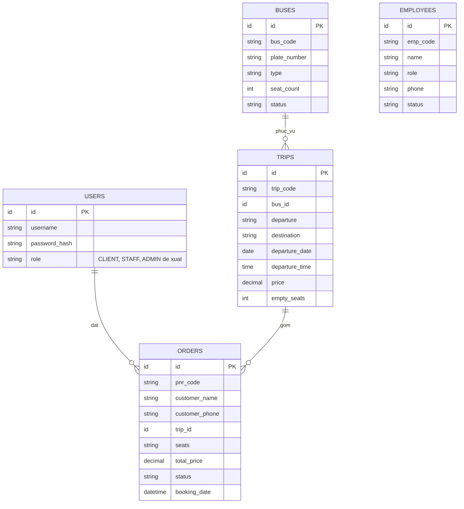

# Phân tích hệ thống đặt vé xe khách

Nhóm 4 thành viên · Dự án Spring Boot · 2026-10-02

## Nghiệp vụ hệ thống

- **Đơn vé (Orders)** — Tạo, sửa, hủy, thanh toán và tra cứu đơn vé.
- **Chuyến xe (Trips)** — Tìm kiếm chuyến, xem chi tiết và kiểm tra số ghế trống.
- **Xe (Buses)** — Thêm, sửa, xóa xe và quản lý trạng thái hoạt động.
- **Nhân viên (Employees)** — Thêm, sửa, cho nghỉ việc và hỗ trợ phân công.
- **Dashboard** — Thống kê doanh thu, vé bán, xe hoạt động và nhân sự.
- **Giao diện khách hàng** — Đặt vé, chọn ghế, tra cứu vé và xem kết quả đặt vé.
- **Xác thực** — Đăng nhập bằng Google (Gmail) hoặc Facebook, phân quyền và bảo vệ API bằng JWT.

## Phân công và phụ thuộc

| Thành viên | Phạm vi |
| --- | --- |
| 1 — Orders & Booking | Xây dựng Order Service, quản lý đơn vé, xử lý thanh toán, cung cấp dữ liệu cho trang kết quả và tra cứu. |
| 2 — Trips & Buses | Xây dựng Trip Service và Bus Service, quản lý chuyến, xe, trạng thái và số ghế trống. |
| 3 — Employees & Dashboard | Xây dựng Employee Service và Dashboard Service, tổng hợp số liệu từ Orders và Trips. |
| 4 — Authentication & Client Integration | Xây dựng Auth Service dùng JWT và tích hợp API vào form đặt vé, trang tra cứu và trang kết quả. |

- Orders cần API Trips để tham chiếu chuyến xe.
- Trang kết quả đặt vé và tra cứu cần API Orders.
- Dashboard cần số liệu từ Orders và Trips. Đề xuất lấy số liệu qua API của service sở hữu dữ liệu.
- Giao diện cần API của các nhóm nghiệp vụ để tích hợp các chức năng tương ứng.

## Sơ đồ dữ liệu

Sơ đồ mô tả quan hệ nghiệp vụ. Mỗi service quản lý và truy cập dữ liệu thuộc phạm vi của mình.



- Khách hàng (`CLIENT`) có thể đặt nhiều đơn. Mỗi đơn thuộc một chuyến, mỗi chuyến sử dụng một xe.
- `ADMIN` có quyền quản lý hồ sơ nhân viên. Có thể lưu người quản lý hồ sơ nếu nghiệp vụ cần.
- Tùy chọn: gắn tài xế hoặc phụ xe với nhiều xe qua bảng trung gian `bus_employees` nếu nhóm xác nhận cần phân công theo xe.

## API dự kiến

| Phạm vi | Phương thức và đường dẫn | Nghiệp vụ |
| --- | --- | --- |
| Orders | `POST /orders` | Tạo đơn vé |
| Orders | `GET /orders/{id}` | Xem chi tiết đơn vé |
| Orders | `PUT /orders/{id}` | Cập nhật đơn vé |
| Orders | `DELETE /orders/{id}` | Hủy đơn vé |
| Orders | `GET /orders/search?pnr=...` | Tra cứu vé |
| Trips | `GET /trips` | Liệt kê chuyến xe |
| Trips | `GET /trips/{id}` | Xem chi tiết chuyến xe |
| Trips | `POST /trips` | Tạo chuyến xe |
| Trips | `PUT /trips/{id}` | Cập nhật chuyến xe |
| Buses | `GET /buses` | Liệt kê xe |
| Buses | `POST /buses` | Thêm xe |
| Buses | `PUT /buses/{id}` | Cập nhật xe |
| Buses | `DELETE /buses/{id}` | Xóa xe |
| Employees | `GET /employees` | Liệt kê nhân viên |
| Employees | `POST /employees` | Thêm nhân viên |
| Employees | `PUT /employees/{id}` | Cập nhật nhân viên |
| Employees | `DELETE /employees/{id}` | Chuyển nhân viên sang trạng thái nghỉ việc |
| Dashboard | `GET /dashboard/stats` | Lấy thống kê tổng hợp |
| Auth | `POST /auth/login` | Đăng nhập |
| Auth | `POST /auth/register` | Đăng ký |
| Auth | `POST /auth/logout` | Đăng xuất |

## Cấu trúc mỗi service Spring Boot

```text
src/main/java/com/project/
  controller/
  service/
  repository/
  model/
  config/
src/main/resources/
  application.yml
Dockerfile
pom.xml
```

## Công nghệ dự kiến

| Hạng mục | Công nghệ và cách dùng |
| --- | --- |
| Frontend | Next.js 16, React 19 và TypeScript trong `FE/`. Giao diện đọc và cập nhật dữ liệu qua API backend. |
| Backend | Java, Spring Boot, Spring Web và Maven trong `BE/`. Spring Web cung cấp REST API, Maven quản lý thư viện và build. |
| Cơ sở dữ liệu | PostgreSQL. Mỗi service dùng Spring Data JPA với Hibernate để truy cập dữ liệu mình quản lý. |
| Xác thực và phân quyền | Spring Security xử lý đăng nhập OAuth 2.0, xác thực JWT và kiểm tra quyền tại API. |
| Email | Spring Boot Starter Mail gửi email qua SMTP. |
| Đóng gói và chạy cục bộ | Docker đóng gói từng ứng dụng Spring Boot. PostgreSQL dùng image riêng. Docker Compose khởi chạy các service và PostgreSQL. |

### Công nghệ cho các service

| Service | Thành viên | Công nghệ và trách nhiệm |
| --- | --- | --- |
| Order Service | 1 | Spring Web cho API `/orders`. Spring Data JPA và PostgreSQL lưu đơn vé và trạng thái thanh toán. Tích hợp VNPay Sandbox và dùng `JavaMailSender` gửi xác nhận vé sau khi thanh toán thành công. |
| Trip Service | 2 | Spring Web cho API `/trips`. Spring Data JPA và PostgreSQL lưu chuyến, thông tin ghế và phân công. Đề xuất lưu `driverId` và gọi Employee Service để kiểm tra tài xế còn làm việc trước khi phân công. |
| Bus Service | 2 | Spring Web cho API `/buses`. Spring Data JPA và PostgreSQL lưu thông tin xe, sức chứa và trạng thái hoạt động. Cung cấp dữ liệu xe cho Trip Service. |
| Employee Service | 3 | Spring Web cho API `/employees`. Spring Data JPA và PostgreSQL lưu hồ sơ, vai trò nghiệp vụ và trạng thái làm việc. Khi nhân viên nghỉ việc, cập nhật trạng thái để giữ lịch sử phân công. |
| Dashboard Service | 3 | Spring Web cho API `/dashboard/stats`. Tổng hợp doanh thu, vé bán, xe hoạt động và nhân sự từ API của các service sở hữu dữ liệu. |
| Auth Service | 4 | Spring Security OAuth2 Client cho đăng nhập Google. Spring Data JPA và PostgreSQL lưu tài khoản và quyền. Cấp JWT để các service nghiệp vụ xác thực và kiểm tra quyền tại API. |

Thành viên 2 và 3 thống nhất cách xử lý khi tài xế xin nghỉ nhưng còn chuyến sắp chạy.

## Yêu cầu chung cho dự án cuối kỳ

Phân công đề xuất theo phạm vi của bốn thành viên.

| # | Yêu cầu | Thành viên phụ trách và cách thực hiện |
| --- | --- | --- |
| 1 | Đăng nhập bằng Gmail hoặc Facebook | **Thành viên 4** triển khai đăng nhập Google (Gmail) bằng Spring Security OAuth2 Client và tích hợp vào giao diện. |
| 2 | Phân quyền tối thiểu ba nhóm | **Thành viên 4** định nghĩa `CLIENT` để đặt và tra cứu vé của mình, `STAFF` để xử lý nghiệp vụ được giao và `ADMIN` để quản trị tài khoản, phân quyền và hồ sơ nhân viên. **Thành viên 1, 2 và 3** áp dụng và kiểm thử quyền trên API mình phụ trách. |
| 3 | Thanh toán online bằng VNPay hoặc MoMo | **Thành viên 1** tích hợp VNPay Sandbox và xác thực thông báo thanh toán trước khi cập nhật đơn vé. **Thành viên 4** tích hợp luồng thanh toán vào giao diện đặt vé. |
| 4 | Truy cập cơ sở dữ liệu qua Spring Data JPA | **Thành viên 1** phụ trách Orders, **thành viên 2** phụ trách Trips và Buses, **thành viên 3** phụ trách Employees, **thành viên 4** phụ trách Auth. Mỗi người dùng JPA repository với Hibernate và PostgreSQL cho phần dữ liệu của mình. |
| 5 | Gửi email bằng Spring Email | **Thành viên 1** dùng Spring Boot Starter Mail và `JavaMailSender` qua SMTP để gửi xác nhận vé sau khi thanh toán thành công. |
| 6 | Tách dự án frontend và backend | **Thành viên 4** phụ trách cấu trúc `FE/` và tích hợp REST API. **Cả bốn thành viên** tổ chức các service mình phụ trách trong `BE/` và viết hướng dẫn chạy tương ứng. |
| 7 | Giao diện dễ nhìn với tối thiểu khoảng 10 màn hình | **Thành viên 1** phụ trách thanh toán và quản lý đơn vé. **Thành viên 2** phụ trách danh sách chuyến, chi tiết chuyến và chọn ghế, quản lý xe. **Thành viên 3** phụ trách dashboard và quản lý nhân viên. **Thành viên 4** phụ trách trang chủ, đăng nhập, kết quả đặt vé, tra cứu vé và phối hợp tích hợp giao diện. |
| 8 | Báo cáo đầy đủ | **Thành viên 3** tổng hợp báo cáo. **Cả bốn thành viên** viết phần nghiệp vụ, dữ liệu, API, giao diện và kiểm thử thuộc phạm vi mình phụ trách. Cả nhóm hoàn thiện phần yêu cầu, kiến trúc và hướng dẫn triển khai. |
| 9 | Mã nguồn được tổ chức tốt | **Cả bốn thành viên** chịu trách nhiệm mã nguồn phần mình. Phân lớp controller, service và repository cho các service Spring Boot theo nhu cầu, kèm kiểm thử và hướng dẫn chạy. |

### Tiêu chí cộng điểm

- **Kiến trúc microservice hợp lý.** Đề xuất **thành viên 2** điều phối tích hợp. Cả nhóm thống nhất ranh giới nghiệp vụ, dữ liệu và API của từng service.
- **Tích hợp AI.** Đề xuất **thành viên 4** phụ trách trợ lý hỏi đáp về tuyến xe và chính sách đặt vé. **Thành viên 1 và 2** cung cấp thông tin nghiệp vụ tương ứng.
- **Công nghệ seminar.** **Cả bốn thành viên** đối chiếu danh sách công nghệ seminar và ghi rõ cách áp dụng trong phần mình phụ trách.
- **Triển khai trên Cloud hoặc Internet.** Đề xuất **thành viên 2** điều phối triển khai backend, **thành viên 4** triển khai frontend và kiểm tra luồng qua URL công khai. Mỗi thành viên xác nhận service mình phụ trách chạy được.
